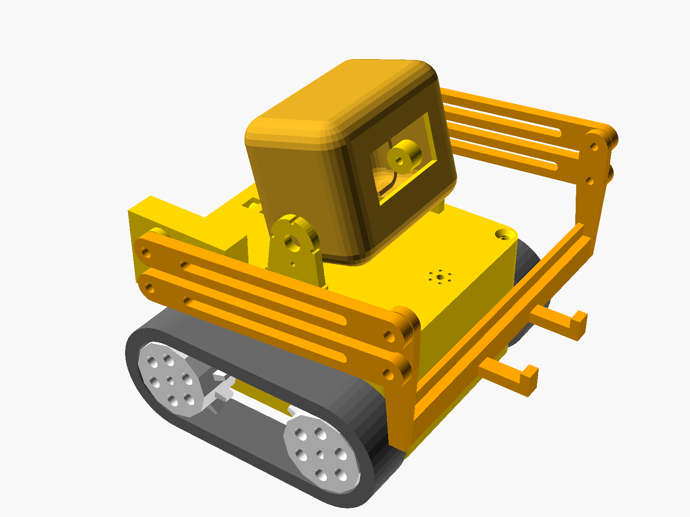
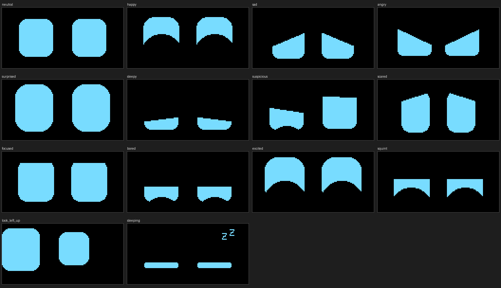
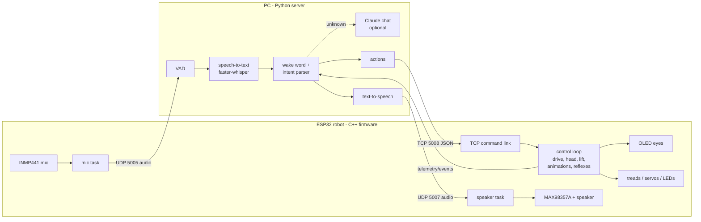

# Cozmo replica — a DIY desk robot (ESP32 + PC brain)

A home-built, Cozmo-style robot: tank treads, a forklift that can pick up a
cube, a tilting head with animated OLED eyes, backpack lights, a speaker and
a microphone. The robot is a thin client. It streams its microphone to your
PC over WiFi, the PC understands what you said, and it sends back actions
and speech that the robot performs.



> This is an independent fan project with its own mechanical design, code,
> animations and sounds. It is not affiliated with or endorsed by Anki or
> Digital Dream Labs, and it uses no material from the original product.

## What it can do

* **Voice control in Turkish or English**: "Cozmo, ileri git", "Kozmo sola
  45 derece dön", "Cozmo dans et", "kolunu kaldır", "adın ne?", "saat kaç?",
  chained commands ("ileri git sonra sağa dön")… about 30 commands. Follow-ups
  within 12 s don't need the name.
* **Talks back** with a small-robot voice (espeak-ng or Piper TTS), and
  optionally **chats freely** through the Claude API for anything the
  built-in commands don't cover.
* **Expressive face**: 12 eased eye expressions, blinking, gaze, eyes that
  bounce while it talks, 18 keyframe animations combining eyes, head, lift,
  treads, chirps and lights.
  
  (rendered from the real firmware code with `tools/face_preview/run.sh`)
* **Local reflexes without the PC**: scared when picked up (treads stop),
  purrs when you pet its head, startles at a clap, gets bored and falls
  asleep, warns about a low battery.
* **Accurate motion**: closed-loop tread speed with encoders, gyro-assisted
  turns, eased servo motion.

## How it works



## Repository layout

| Folder | Contents |
|--------|----------|
| [`firmware/`](firmware) | ESP32 firmware, PlatformIO, C++17. Own drivers for every part in `src/drivers/`. |
| [`server/`](server) | Python PC server: audio, VAD, ASR, intents, TTS, optional Claude chat. [README](server/README.md) |
| [`hardware/3d/`](hardware/3d) | Parametric OpenSCAD models + ready STLs |
| [`tools/`](tools) | `robot_console.py` (manual control / calibration), `fake_robot.py` (server test without hardware), `face_preview/` (render the eyes on a PC) |
| [`docs/`](docs) | [Bill of materials](docs/BOM.md) · [Wiring](docs/WIRING.md) · [Printing & assembly](docs/ASSEMBLY.md) · [Protocol](docs/PROTOCOL.md) |

## Budget

About **3430 TL** of the 4000 TL budget, with the ESP32 and microphone you
already have. Full list with cheaper options: [docs/BOM.md](docs/BOM.md).

## Quick start

### 1. Firmware

Install [PlatformIO](https://platformio.org/install) (VS Code extension or
`pip install platformio`), then:

```bash
cd firmware
```

```bash
cp include/secrets.example.h include/secrets.h
```

Edit `include/secrets.h` with your WiFi name and password, connect the ESP32
over USB and flash:

```bash
pio run -t upload
```

```bash
pio device monitor
```

All pins and calibration values are in `firmware/include/config.h`.

### 2. PC server

```bash
cd server
```

```bash
pip install -e ".[whisper]"
```

```bash
python -m cozmo_server
```

Install `espeak-ng` for speech output (see [server/README.md](server/README.md)).
The robot finds the PC automatically on the same WiFi. Say
**"Cozmo, merhaba!"**

### 3. Build it

Print the parts and follow [docs/ASSEMBLY.md](docs/ASSEMBLY.md) and
[docs/WIRING.md](docs/WIRING.md). Test the electronics on a breadboard with
`python tools/robot_console.py` before closing the body.

## Firmware architecture

| Layer | Files |
|-------|-------|
| Drivers | `Ssd1306` (OLED), `I2sMicrophone`, `I2sSpeaker`, `Drv8833`, `WheelEncoder`, `ServoPwm`, `Mpu6050`, `Ws2812`, `Battery`, `TouchPad` |
| Motion | `DriveController` (PI speed loop, distance ramps, gyro turns), `SmoothJoint` (eased servos in degrees / mm) |
| Face | `Face`: procedural eyes, 12 expressions, blink, gaze, talking bounce |
| Behaviour | `Animations` (18 keyframe animations), `BackpackLights` |
| Network | `Link` (WiFi, discovery, JSON commands), `AudioStreamer` (mic ↔ UDP ↔ speaker) |
| Robot | `Robot`: command dispatch, telemetry, reflexes, idle personality |

FreeRTOS tasks: control loop and display/IMU task on core 1; WiFi, mic and
speaker tasks on core 0.

## Development

```bash
cd firmware && pio run
```

```bash
cd server && python -m pytest
```

Commit messages follow [Conventional Commits](CONTRIBUTING.md).
